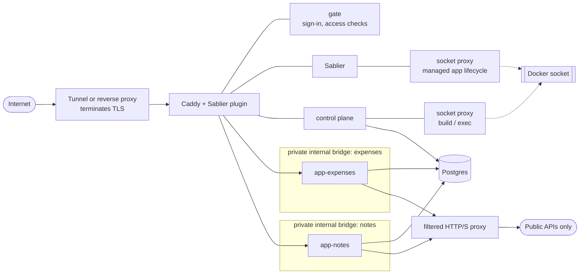

<p align="center">
  
</p>

**Your own Vercel, on a 4 GB box in a cupboard.** Apps sleep when nobody uses
them, wake in about a second, and share one login and one Postgres. Ships with a
**Claude skill that writes and deploys new apps from a sentence** —
[jump to it](#build-apps-by-asking).

<p align="center">
  
</p>

  

---

## The idea

A budget tracker you open twice a week doesn't deserve a VPS. But five of them on
one small machine means five idle Node processes eating the RAM you needed for
the sixth.

So Nanodeploy stops them. An app with no traffic is a stopped container — zero
RAM, zero CPU — and the next request starts it back up before the page finishes
loading. A Jetson Nano with five apps deployed sits at **1.4 GB of 4 GB**,
Postgres, identity provider and gateway included.

You still get what makes hosting worth it: a domain per app, HTTPS, one account
across everything, a database per app, and a deploy that is one command or one
drag of a `.zip`.

## What it costs to run

| Component | Job | RAM at rest |
|---|---|---|
| Caddy + Sablier plugin | routing, static files, waking apps | ~25 MB |
| Sablier | stops and starts containers on demand | ~15 MB |
| Postgres 16 | one database and one role per app | ~60 MB |
| gate | accounts, passwords, passkeys, app roles, access checks | ~40 MB |
| control plane | uploads, provisioning, routes | ~50 MB |
| two socket proxies | least-privilege Docker access | ~10 MB |

A woken app costs ~40 MB, capped at 256 MB. One that must answer instantly can
opt out of sleeping for that same 40 MB, permanently. In the app's **Settings**,
check **Always on** to wake it immediately and keep it running. Unchecking it
puts it back to sleep until the next visit. Changing this setting restarts the
backend; the choice survives deployments, rollbacks and server restarts.
Static websites are already always available.

## Deploying

```bash
cp -r templates/app-template my-app && cd my-app
npm install
export NANODEPLOY_URL=https://deploy.apps.example.com NANODEPLOY_TOKEN=ndd_...
npm run deploy
```

Your machine builds; the server compiles nothing. It gets a zip, builds a small
image, runs migrations once, and puts the container back to sleep. No terminal?
Choose **New application → ZIP archive** and drop your zip there.

The token is a **deploy key**: made in an application's **Settings**, or under
**New application → Terminal & agents** before its first deploy, it deploys that
one app and reads its logs, nothing else. Give one to each CI job or AI agent; the server's own
`DEPLOY_TOKEN` can do everything and should stay on the server.

**Every deploy is a version.** It is prepared next to the running one and
swapped in once the image is built and the migrations ran, so a broken bundle
fails without touching what is live. Each app's panel lists its versions, with
the message and commit `npm run deploy -- -m "..."` sent, and goes back to any
of the last ten in one click: the last three keep their image, so that is a
container swap, not a build. Dropping a new zip on an existing app shows what
would change (files, migrations, variables to set) before anything goes live.

Before applying a migration, the app's database is dumped. If a migration fails,
it is put back on the spot; when you go back to a version older than a
migration, you choose between keeping the data (the old code meets a newer
schema) and restoring the database as it was (everything written since is
lost).

The whole contract is one file:

```yaml
name: Expenses
slug: expenses          # -> expenses.apps.example.com
access: private         # public | private | groups, for a new app only
backend: { entry: server.js, port: 3000 }
database: { enabled: true, migrations: ./migrations }
idle: { timeout: 10m, warm: false }
env: [OPENAI_API_KEY]   # names only, values are typed in the dashboard
```

## Running it


Open an application for its overview and recent activity. **Deployments** holds
its version history, **Access** controls who can open it, **Settings** contains
environment variables and deploy keys, and **Logs** shows its recent output.
You can search and filter applications, switch between cards and a list, or open
an application directly from its card. The console also adapts to your phone.

Access changes take effect immediately, and a redeploy never changes them back:
`access` in `app.yaml` only applies when the app is created. **private** (accounts you created),
**groups** (people you pick), or **public** (the whole internet — the dashboard
warns you). Env values are write-only: you can replace a secret, not read it back.

## Push to deploy, from GitHub or GitLab

Connect a forge in **Git deployments**, pick a repository and a branch, and every
push to it deploys. **GitHub**: one click creates a private GitHub App for your server
(GitHub's manifest flow), you choose which repositories it may read. **GitLab**:
paste a project access token, the webhook is installed for you.

A push queues a build. One build runs at a time, so a 4 GB machine is never
building twice:

1. the control plane downloads the commit's archive (the forge token never
   enters the build);
2. `npm ci` (or `npm install`) and `npm run build` run in a throwaway container
   as uid 1000, with no capability, 1.5 GB of memory, and a network of its own
   that reaches the package registry and nothing of the platform;
3. the result goes through the same release pipeline as a dropped zip: a new
   version, live, with the commit in its history;
4. the commit gets a green or red status, linking to the app or to the build log.

Each pull request gets a **preview** at `<app>--pr-<n>.apps.example.com`, for
accounts of your server only, with its own empty database and the production
app's variables. It sleeps like any app (zero memory at rest), is updated by each
push to the branch, and goes away when the pull request is closed. Pull requests
from forks are never built.

Change how a repository builds in `app.yaml`:

```yaml
build:
  image: node:20-bookworm-slim   # default
  install: npm ci                # default: npm ci with a lockfile, npm install without
  command: npm run build         # must leave dist/ (and server.js if there is a backend)
```

Behind a home router, the webhook must reach `https://deploy.apps.example.com/hooks/`:
if the console sits behind Cloudflare Access, let that path through. "Build now"
in the Git tab deploys the branch head without a webhook.

## Analytics, without a script in your apps

The Analytics tab reads what the machine already knows: Caddy's access log
(visitors, page views, referrers, countries, devices, errors, latency), Docker's
events (when each app woke up, went to sleep, crashed or ran out of memory, and
how long a cold start took), a memory sample of each awake app every minute, and,
for apps that are not public, which accounts used them on which days.

No cookie, no third-party script, no extra service. A visitor is counted with a
hash of a salt that changes every midnight, the app, the address and the browser:
countable within a day, never followable from one day or one app to the next.
Addresses are not stored. Behind Cloudflare, the country comes from its header for
free. A single-page app reports its client-side navigations with one call,
`trackPage()` in the template's `src/analytics.ts`. Set `TIMEZONE` in `.env` so
"today" starts at your midnight.

## One account for everything


Invite someone from the dashboard, hand over the single-use link, and they
choose a password, a passkey, or both. That one account opens every app they're
allowed to see, and your apps write zero auth code: the gateway hands them the
user, and their roles in that app, in headers.

**Public app, private moderation.** An app can be open to the whole internet
and still have a back office:

```yaml
access: public
roles: [moderator]
protect:
  - { path: /api/admin/*, role: moderator }
```

Anyone reads and posts; `/api/admin/*` asks for a sign-in and the role. Who is a
moderator is a click in the app's panel. On public pages the app still learns
who is signed in, so it can show the moderation buttons to the right people.

Each person has an account page at `auth.apps.example.com`: password, passkeys,
and personal access keys for scripts that call their apps. A session is bound
to one host: an app never receives a cookie it could replay anywhere else. The
console asks you to confirm it is you every 12 hours, and only accounts flagged
as administrators reach it. Scripts and AI agents get a deploy key per app.

## How it is wired



Each app has its own internal bridge without a host gateway. It reaches Caddy,
Postgres and an egress proxy for public HTTP/S; neighbouring backends, the LAN,
host services, gate and Docker proxies have no direct route. Node 24 and npm
use the configured proxy automatically; other HTTP libraries need proxy support.
Sablier and the control plane each get a separate Docker proxy. Apps run non-root,
all capabilities dropped, read-only root filesystem, bounded memory/CPU/pids and
logs, and no published port. Git builders have private tmpfs work/cache mounts
and no host files or production secrets.

## Install

You need Docker + Compose v2 (on storage that isn't an SD card), a domain with a
**wildcard** `*.apps.example.com` pointing at the machine (a
[Cloudflare tunnel](https://developers.cloudflare.com/cloudflare-one/connections/connect-networks/)
is easiest behind a home router), and Node 24 on your laptop.

```bash
git clone https://github.com/theosorus/nanodeploy && cd nanodeploy
./install.sh          # writes .env with fresh secrets, then stops
$EDITOR .env          # set APPS_DOMAIN and APPS_DIR
./install.sh          # builds and starts everything
```

Then point your tunnel at `http://localhost:8080` and open the one-time link the
control plane prints in its logs (`docker compose logs control-plane | grep -A1
SETUP`) to create your administrator account. The installer prints each step
with your domain filled in. Upgrading from a version that used Pocket ID? Start
it once with `docker compose --profile legacy up -d pocket-id` and restart the
control plane: accounts and groups are imported with their ids, so no app loses
its data, and everyone gets a link to set a password or a new passkey.

> **The wildcard is not optional.** The tunnel rule says where a request goes
> once it arrives; the `*` DNS record is what makes it arrive. With the first but
> not the second, every app deploys and runs while the browser says "server not
> found".

After a power cut the machine comes back on its own, if you install the unit
once (`sudo cp nanodeploy.service /etc/systemd/system/ && sudo systemctl enable
nanodeploy`): the control plane rebuilds any missing container, image or route
from the bundles on disk. Back up with `pg_dumpall`, and stop with `docker
compose stop`, never `down` — `down` deletes the networks and the app containers
become unstartable.

## Keeping it up to date

`./scripts/update.sh`, run every five minutes by `nanodeploy-update.timer`,
deploys each new commit of `main` once its CI is green: it backs up first
(`scripts/backup.sh`), checks the console still lists every app afterwards, and
goes back to the previous commit if not. [docs/UPGRADING.md](docs/UPGRADING.md)
has the setup, and the one-time steps from a version that used tinyauth and
Pocket ID.

The [November 2026 security upgrade](docs/UPGRADING.md#security-upgrade-7-november-2026)
requires a backup and a manual first installation: it encrypts stored app
secrets and recreates legacy containers/networks. Keep the existing encryption
key; a code-only rollback to the old plaintext format is incompatible.

## Build apps by asking

"Build me an app" fails with a chatbot because there are a thousand ways to
build it. Here there is one: fixed frontend, backend, database, auth, deploy.
Nothing to get wrong. So Nanodeploy ships a Claude skill,
[`skills/nanodeploy-app/`](skills/nanodeploy-app), with the whole contract built
in. Install it and describe what you want:

> **You:** build me something to track shared expenses with my flatmates

It asks the questions that change the result — who it's for, what data, and
**three named art directions** so it doesn't look like every other generated app
— then writes the schema, API, frontend and manifest and deploys it. You get a
URL. It also knows what quietly breaks a sleeping app (no in-memory state, no
timers, the first-wake retry, an `ownerId` filter on every query), so the result
survives its second visit.

Prefer to write it yourself? [`app-template/`](templates/app-template) is the
same starting point: `cp -r`, edit, `npm run deploy`.

## What it does not do

Stated plainly, because finding out later is worse:

- **Analytics are approximate by design.** One person on two days counts twice;
  a privacy-minded browser behind a VPN may count twice in one day. Bots are
  filtered by user agent only.
- **History is short.** Ten versions per app keep their files, three their
  image, three their database snapshot. Older ones are cleaned up.
- **Containers share the host kernel.** Keep the OS, Docker and images patched;
  this isolation is not a separate virtual machine per app.
- **A compromised app can export its own secrets over public HTTPS.** Stored
  app/forge credentials are encrypted, but the running app needs its own values.
  Encrypt full backups, which include the database and its encryption key.
- **Nothing is backed up for you.** One shared Postgres, one point of loss.
- **Websockets don't survive sleeping.** Poll, or use reconnecting SSE.
- **The first request after sleeping gets a waiting page**, not JSON — the
  template's fetch wrapper retries it; a bare `fetch` breaks silently.
- **Rate limits are local and storage is shared.** Authentication/API budgets
  and bounded container resources reduce abuse; app data volumes have no disk
  quotas and a sustained denial of service still needs host/edge protections.

[SECURITY.md](SECURITY.md) is the full threat model: what is enforced, and what
is deliberately not.

## Licence

MIT. See [LICENSE](LICENSE) and [CONTRIBUTING.md](CONTRIBUTING.md).
