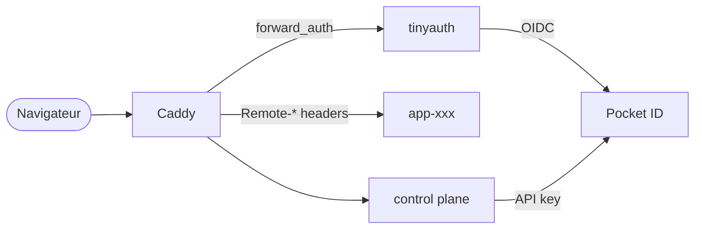
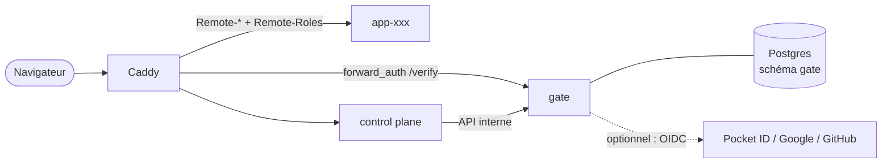
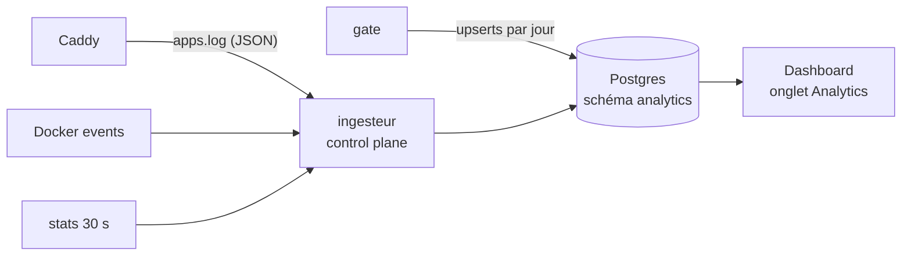
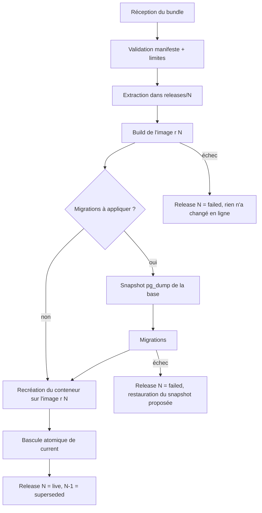
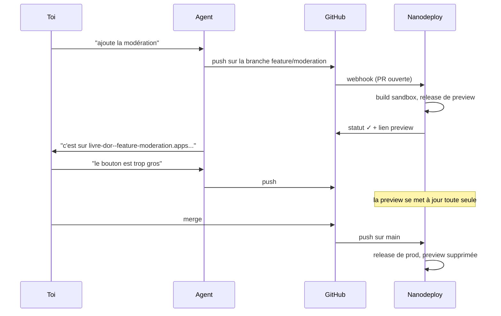

# Nanodeploy : utilisateurs, analytics, versions et Git

*Document de conception. Novembre 2026. Rédigé à partir d'une lecture complète du
control plane (`control-plane/src`), du Caddyfile, du compose, du template et du
skill, plus des recherches sur les briques existantes (tinyauth, Pocket ID, Caddy,
API GitHub et GitLab, méthodes d'analytics sans cookie).*

Ce document traite trois chantiers : **la gestion des utilisateurs et des accès**,
**les analytics**, et **les versions avec le déploiement depuis Git**. Pour chacun :
le problème tel qu'il se pose dans le code actuel, les options étudiées, une
recommandation argumentée, le modèle de données, les extraits de configuration
qui comptent, l'UX, les risques et le coût sur une machine de 4 Go.

Les choix de cadrage (réponses à mes questions) :

| Question | Réponse |
|---|---|
| Qui modère une app publique ? | Moi et quelques proches, avec un vrai compte |
| Où tourne le build d'un dépôt Git ? | Sur le serveur (mode Vercel) |
| Quelles forges ? | GitHub et GitLab.com |
| Analytics anonymes ou nominatives ? | Les deux : anonyme pour le public, nominatif pour les comptes |

---

## Sommaire

0. [Résumé en une page](#0-résumé-en-une-page)
1. [État des lieux et quatre constats préalables](#1-état-des-lieux-et-quatre-constats-préalables)
2. [Axe 1 : utilisateurs, mots de passe, rôles, clés d'accès](#2-axe-1--utilisateurs-mots-de-passe-rôles-clés-daccès)
3. [Axe 2 : analytics](#3-axe-2--analytics)
4. [Axe 3 : versions, remplacement à chaud, Git](#4-axe-3--versions-remplacement-à-chaud-git)
5. [Chantiers transverses](#5-chantiers-transverses)
6. [Feuille de route](#6-feuille-de-route)
7. [Questions encore ouvertes](#7-questions-encore-ouvertes)
8. [Sources](#8-sources)

---

## 0. Résumé en une page

**Utilisateurs.** Le système actuel empile deux outils (Pocket ID pour les comptes
et les passkeys, tinyauth pour le forward-auth) et ne connaît que trois modes
d'accès par app, appliqués en bloc à tout le domaine. Pocket ID refuse les mots de
passe par conception, tinyauth a ses propres utilisateurs dans un fichier : ajouter
des mots de passe avec ces briques donnerait **deux annuaires**, exactement le
"pas clair" qu'on veut quitter. Recommandation : remplacer les deux par un petit
service maison, **`gate`** (~40 Mo de RAM, Hono comme le reste), qui porte un seul
annuaire en Postgres, plusieurs méthodes de connexion (mot de passe, passkey,
plus tard code par email), des **rôles par app** (`moderator`, `editor`...), des
**chemins protégés** (`/admin/*` réservé aux modérateurs sur une app publique) et
une **identité optionnelle** : sur une app publique, l'app reçoit quand même
l'identité du modérateur s'il est connecté. S'ajoutent trois types de **clés
d'accès** : clés personnelles (scripts), clés de déploiement limitées à une app
(CI, agents IA), et le jeton racine actuel gardé en secours.

**Analytics.** Pas de Plausible ni d'Umami (trop lourds ou redondants ici). Quatre
sources déjà présentes sur la machine suffisent : les **logs d'accès Caddy** (trafic,
visiteurs uniques par hash quotidien, pages, référents, erreurs, latence), les
**événements Docker** (réveils, mises en veille, crashs, OOM : la frise "allumée /
éteinte"), des **échantillons mémoire** toutes les 30 s, et le **`gate`** qui sait
*qui* visite (nominatif, pour les comptes). Un beacon optionnel de 20 lignes compte
les navigations SPA. Tout atterrit dans Postgres en tables agrégées, affiché dans un
nouvel onglet du dashboard en SVG inline. Coût : quelques Mo.

**Versions et Git.** Le déploiement actuel efface le dossier de l'app *avant* de
builder l'image : pendant le build le site est cassé, et si le build échoue il
reste cassé, sans retour possible. Fondation : des **releases immuables** (un
dossier par version, un lien symbolique `current` basculé atomiquement), une
table `releases`, un **rollback** en un clic, et un **snapshot de la base avant
chaque migration**. Par-dessus : un bouton **"Nouvelle version"** par app (drag
and drop avec diff du manifeste avant confirmation), puis la **connexion GitHub
(GitHub App créée en un clic par le flux "manifest") et GitLab.com (jeton de
projet)**. Un push déclenche un webhook signé, le control plane télécharge
l'archive du commit, la build tourne dans un **conteneur sandbox** à mémoire
bornée (1,5 Go, réseau isolé, une build à la fois), et le résultat passe par le
même pipeline de release que le zip. Bonus quasi gratuit grâce au scale-to-zero :
des **previews par branche ou par PR** (`monapp--feature-x.apps.example.com`) qui
ne coûtent zéro RAM au repos.

**Ordre conseillé** : phase 0 (corriger quatre défauts trouvés en lisant le code,
dont une fuite probable de cookie de session vers les apps), puis `gate`, puis
releases, puis analytics, puis Git, puis previews. Le détail et les estimations
sont en [section 6](#6-feuille-de-route).

---

## 1. État des lieux et quatre constats préalables

### 1.1 Comment ça marche aujourd'hui



* **Comptes** : Pocket ID, passkeys uniquement. Le control plane lit et écrit les
  utilisateurs et groupes via l'API Pocket ID (`people.ts`).
* **Session** : tinyauth, cookie posé sur le domaine parent pour couvrir toutes
  les apps.
* **Accès à une app** : un champ `access` (`public | private | groups`) traduit en
  Caddyfile par `caddy.ts`. `private` = forward-auth sur *tout* le site. `groups` =
  forward-auth plus une regex sur `Remote-Groups`. `public` = aucun forward-auth,
  donc **aucune identité** transmise à l'app, même si la personne est connectée.
* **Console** : jeton `DEPLOY_TOKEN` unique (accès total) ou session d'un compte
  `isAdmin` côté Pocket ID.
* **Déploiement** : `POST /api/deploy` avec un zip, `doDeploy()` remplace tout.

### 1.2 Pourquoi le cas "public + modérateur" est impossible

Le mode est binaire **par site entier**. Caddy applique `import nanodeploy_auth`
sur tout l'hôte ou pas du tout (`renderSite`, `caddy.ts:26`). Il n'existe ni
protection par chemin, ni identité optionnelle, ni notion de rôle propre à une
app. D'où le contournement actuel : app publique plus "token modérateur" bricolé
dans l'app, avec son propre login. Deux systèmes d'auth, aucun des deux vraiment
géré par la plateforme.

### 1.3 Quatre constats à corriger avant tout (phase 0)

Je les ai trouvés en lisant le code. Ils ne sont pas dans la demande mais ils
conditionnent les trois axes.

**C1. Le cookie de session part probablement vers le backend de chaque app.**
Le cookie tinyauth est posé sur le domaine parent (`.apps.example.com`) pour que la
session couvre toutes les apps. Le navigateur l'envoie donc à *chaque*
sous-domaine, y compris aux apps publiques, et Caddy le transmet tel quel au
conteneur (`reverse_proxy` relaie l'en-tête `Cookie`). Or une app est du code
arbitraire (souvent généré, avec ses dépendances npm), et elle a accès à internet.
Une app malveillante ou compromise peut lire le cookie de l'admin qui la visite et
le rejouer contre `deploy.apps.example.com` depuis l'extérieur, via le tunnel.
Le garde `sameOrigin` ne l'arrête pas : une requête serveur à serveur n'a ni
`Origin` ni `Sec-Fetch-Site`, et elle est traitée comme un appel CLI
(`index.ts:97`). Résultat possible : déployer du code arbitraire avec la session
de l'admin. **Confirmé** : le code de tinyauth v5.1.3 nomme ses cookies
`tinyauth-session-<id>` (et `-csrf`, `-redirect`, `-oauth`), les pose sur le
domaine parent par défaut (`SubdomainsEnabled: true`), et un test avec Caddy
2.11.4 montre que le backend d'une app publique les recevait. **Corrigé en phase
0** : Caddy retire tout cookie `tinyauth-*` dans la route `/api/*` de chaque app,
après le forward-auth. Correctif durable : la session de console
devient un cookie distinct, limité à l'hôte `deploy.` (voir 2.7).

**C2. Un redéploiement écrase le mode d'accès choisi dans le dashboard.**
`doDeploy()` réécrit `access` et `groups` depuis le manifeste à chaque déploiement
(`index.ts:262-266`). Passer une app en privé dans le dashboard puis redéployer la
remet silencieusement en public si `app.yaml` dit `public`. Avec le déploiement
automatique depuis Git, ce piège se déclencherait à chaque push. Règle proposée :
le manifeste donne la valeur **à la création**, ensuite le dashboard fait foi, et
un déploiement dont le manifeste diverge affiche un avertissement au lieu
d'écraser.

**C3. Le site est cassé pendant toute la durée d'un déploiement.**
`doDeploy()` commence par `rm -rf` du dossier de l'app (`index.ts:212`), puis
extrait, migre et builde l'image. Pendant ce temps Caddy sert un dossier vide ou
partiel. **Constaté en test** : si le build Docker échoue, le nouveau frontend
reste en ligne alors que le backend est resté sur l'ancienne image, donc l'app
tourne à moitié mise à jour, et le dossier sur disque n'a plus de quoi
reconstruire l'image. **Corrigé en phase 0** : extraction dans un dossier de
préparation, image construite avant les migrations, bascule par `rename` seulement
quand tout a réussi. Les releases de l'axe 3 vont plus loin (historique, rollback).

**C4. Le jeton racine est donné aux agents IA.**
Le skill demande `NANODEPLOY_TOKEN` pour déployer, c'est-à-dire le `DEPLOY_TOKEN`,
équivalent root sur la machine (build d'images, exec dans les conteneurs). Un
agent qui itère sur une app n'a besoin que de déployer *cette* app. **Corrigé en
phase 0** : les clés de déploiement `ndd_` de la section 2.6 existent déjà dans le
control plane actuel (table `deploy_keys`, routage Caddy, panneau du dashboard),
sans attendre `gate`. Le skill demande désormais une clé au lieu du jeton.

---

## 2. Axe 1 : utilisateurs, mots de passe, rôles, clés d'accès

> **Livré en phase 1.** `gate/` remplace tinyauth et Pocket ID. Ce qui a changé
> par rapport au plan ci-dessous, après implémentation :
>
> * **Sessions liées à un hôte.** Au lieu d'un cookie partagé sur le domaine
>   parent (2.7), une session racine vit sur `auth.` et chaque autre hôte reçoit
>   sa propre session via un code à usage unique (60 s), en cookie `__Host-`. Un
>   cookie copié par une app ne sert que sur cette app : testé. La console en
>   profite, avec une session de 12 h maximum depuis la dernière preuve
>   d'identité.
> * **Manifeste à plat**, compatible avec l'existant : `access` garde ses trois
>   valeurs (`private` joue le rôle de `members`, `groups` de `restricted`), et
>   `roles` / `protect` sont des clés de premier niveau.
> * **Pas de rôle implicite `viewer`** : `Remote-Roles` ne contient que les rôles
>   déclarés et détenus.
> * **Pas encore** : TOTP, code par email, OIDC externe. Les pages de connexion
>   parlent français et anglais (le dashboard garde ses 10 langues).
> * **Le schéma `gate` est créé par le control plane**, seul à avoir le droit de
>   créer des rôles Postgres ; il gère aussi comptes, groupes et rôles
>   directement en base, sans API interne.

### 2.1 Le besoin, reformulé

1. **Un seul annuaire**, compréhensible : une personne = un compte, quel que soit
   le moyen de se connecter.
2. **Mots de passe** en plus des passkeys (pour les proches qui n'ont pas de
   passkey, un vieux téléphone, un PC partagé).
3. **Clés d'accès** pour les machines : scripts, CI, agents IA.
4. **Le mélange public / protégé dans une même app** : visiteurs anonymes sur
   le site, modérateurs authentifiés sur l'admin, et l'app qui sait reconnaître
   un modérateur connecté même sur les pages publiques (pour afficher un bouton
   "supprimer" sous un commentaire, par exemple).
5. **Que la plateforme le gère**, pas l'app : zéro code d'auth dans les apps,
   comme aujourd'hui, juste des en-têtes plus riches.

### 2.2 Options étudiées

| Option | Mots de passe | Rôles par app | Chemins protégés | Identité optionnelle sur le public | Un seul annuaire | RAM | Verdict |
|---|---|---|---|---|---|---|---|
| Garder Pocket ID + tinyauth, ajouter des règles | non (Pocket ID est passkey-first, avec au mieux un code par email si SMTP) | non | oui côté tinyauth (`path.allow` / `path.block`) | non documenté | non | 25 Mo | insuffisant |
| tinyauth seul, utilisateurs locaux | oui (fichier d'utilisateurs, hash bcrypt) | non (allow/block par nom) | oui | non documenté | oui mais dans un fichier | 10 Mo | gestion par fichier, pas de rôles, CVE récente sur `users.allow` vide en 5.0.7 |
| Authelia | oui (fichier ou LDAP) + TOTP + WebAuthn en 2FA | via groupes seulement | oui, règles riches (`bypass`, `one_factor`, `two_factor` par domaine, chemin, méthode) | non (`bypass` ne transmet pas d'identité) | oui mais YAML | 30 à 50 Mo | solide, mais annuaire en fichier, pas d'API de gestion, pas de rôles par app |
| Authentik, Keycloak, Zitadel | oui | oui | oui | partiellement | oui | 500 Mo à 1 Go et plus | trop lourd pour la cible |
| **`gate` maison** | oui | **oui** | **oui** | **oui** | **oui, en Postgres** | **~40 Mo** | **recommandé** |

Le point qui tranche : aucune brique légère ne fait de **l'identité optionnelle**
(laisser passer un anonyme *et* transmettre l'identité quand il y en a une) ni des
**rôles propres à chaque app** injectés en en-tête. Or c'est exactement le cas
d'usage. Et la plateforme a déjà toute la machinerie autour (Postgres, Hono,
dashboard, Caddy généré) : le service manquant est petit.

Le prix honnête : **on devient responsable d'un composant de sécurité**. La section
2.7 liste ce qu'il faut faire bien, et la surface est volontairement réduite
(pas d'OAuth serveur, pas de fédération, pas d'inscription publique).

### 2.3 Architecture recommandée : `gate`



* **Un conteneur `gate`**, Node 20 + Hono, sur `nanodeploy_edge` (joignable par
  Caddy) et `nanodeploy_data` (Postgres). **Jamais sur `nanodeploy_apps`** : une app
  ne doit pas pouvoir lui parler directement, même règle que pour le control
  plane.
* **Séparé du control plane** exprès : `gate` est appelé à chaque requête de
  chaque app, y compris par des inconnus sur internet. Le control plane est
  équivalent root. Les mélanger exposerait le composant le plus dangereux au trafic
  le plus hostile. `gate` n'a ni socket Docker ni accès aux fichiers des apps.
* **Son propre rôle Postgres**, limité au schéma `gate`. Le control plane lui
  parle par une petite API interne authentifiée (jeton partagé sur le réseau
  edge) pour gérer comptes, groupes, rôles et clés.
* **Il remplace tinyauth et Pocket ID.** Net : environ +15 Mo par rapport à
  aujourd'hui, mais une étape d'installation en moins (plus de client OIDC à
  créer à la main, plus de clé API Pocket ID à copier dans `.env`). L'installeur
  devient : `./install.sh`, puis "créez votre compte" sur `auth.apps.example.com`.

### 2.4 Le modèle

#### Identités et méthodes de connexion

Un **compte** (`users`) porte : id (UUID), nom d'utilisateur, email, nom affiché,
statut (actif, suspendu, invité). Il peut avoir **plusieurs facteurs** :

| Méthode | Usage | Notes |
|---|---|---|
| Mot de passe | défaut pour les proches | hash `scrypt` natif Node (aucune dépendance native à compiler sur ARM), paramètres calibrés pour ~100 ms sur le Jetson |
| Passkey (WebAuthn) | recommandé, obligatoire pour les admins à terme | `@simplewebauthn/server` (pur JS). RP ID = `apps.example.com` pour que la passkey serve sur tous les sous-domaines |
| TOTP | second facteur optionnel du mot de passe | appli d'authentification classique |
| Code par email | plus tard, seulement si SMTP configuré | utile pour "mot de passe oublié" |
| OIDC externe | optionnel, phase ultérieure | "Se connecter avec Pocket ID / GitHub / Google", lié à un compte existant par email vérifié, jamais de création automatique |

Pas d'inscription publique, comme aujourd'hui : un compte naît d'une
**invitation** (lien à usage unique, 7 jours) où la personne choisit son mot de
passe et/ou enregistre une passkey. Sans SMTP, le dashboard affiche le lien à
copier, comme maintenant. Mot de passe oublié sans SMTP : l'admin génère un lien
de réinitialisation.

#### Rôles globaux

| Rôle | Peut |
|---|---|
| `owner` | tout, ne peut pas être retiré, il en existe toujours au moins un |
| `admin` | piloter la console (déployer, env, accès, comptes) |
| `member` | se connecter et ouvrir les apps qui le lui permettent |

Ça reprend la logique actuelle (`isAdmin` de Pocket ID) mais dans notre propre
base, avec la règle "jamais zéro admin" déjà codée dans `index.ts:632-645`.

#### Groupes

Gardés, mais natifs à `gate` : "famille", "coloc", "asso". Ils servent à donner
un accès ou un rôle à plusieurs personnes d'un coup. Avantage immédiat : plus de
regex de groupes dans le Caddyfile, plus de reload Caddy quand on change un accès
(voir 2.8), plus de bug de renommage de groupe à propager (`index.ts:654-684`).

#### Rôles par app (la nouveauté centrale)

Chaque app **déclare** ses rôles dans son manifeste, et l'admin **attribue** ces
rôles à des personnes ou des groupes depuis le dashboard.

```yaml
# app.yaml
name: Livre d'or
slug: livre-dor
access:
  visitors: public              # public | members | restricted
  roles: [moderator]            # roles this app understands, besides "viewer"
  protect:
    - path: /api/admin/*
      role: moderator
    - path: /admin*
      role: moderator
```

* `visitors` : qui peut ouvrir l'app tout court.
  * `public` : tout internet.
  * `members` : tout compte du serveur (l'actuel `private`).
  * `restricted` : seulement les personnes ou groupes ayant au moins un rôle dans
    l'app (l'actuel `groups`, mais par personne *ou* par groupe).
* `roles` : vocabulaire propre à l'app. `viewer` est implicite.
* `protect` : chemins qui exigent un rôle. Vérifié par `gate` **et** rappelé à
  l'app via les en-têtes, pour une défense en profondeur.

Le manifeste déclare, le dashboard attribue : le dépôt Git d'une app ne peut donc
pas s'auto-attribuer des modérateurs, et changer un modérateur ne demande pas de
redéploiement. Les attributions vivent dans `app_role_grants`.

#### Ce que reçoit l'app

Toujours après suppression par Caddy des mêmes en-têtes venus du client :

| En-tête | Contenu |
|---|---|
| `Remote-Sub` | id stable du compte (même valeur qu'aujourd'hui, voir migration 2.11) |
| `Remote-User` | nom d'utilisateur |
| `Remote-Email`, `Remote-Name` | inchangés |
| `Remote-Groups` | groupes, séparés par des virgules |
| `Remote-Roles` | **rôles du compte dans cette app**, ex. `moderator,viewer` |
| `Remote-Via` | `session` ou `key` (une clé d'accès personnelle) |

Sur une app publique, un visiteur anonyme arrive **sans** ces en-têtes ; un
modérateur connecté arrive **avec**. C'est l'identité optionnelle.

### 2.5 Le cas d'usage, de bout en bout

**Le livre d'or public modéré par toi et deux proches.**

1. Le manifeste ci-dessus est déployé. Le dashboard affiche : *Visiteurs : public.
   Rôles : moderator (personne pour l'instant).*
2. Dans l'onglet de l'app, tu attribues `moderator` à toi et au groupe "famille".
3. Un visiteur anonyme ouvre `livre-dor.apps.example.com` : Caddy demande à
   `gate`, qui répond 200 sans identité. L'app lit les messages, affiche le
   formulaire. Rien ne change pour lui.
4. Ta cousine clique sur le petit lien "Modération" en pied de page, qui pointe
   vers `/_nd/login?next=/admin`. Caddy redirige vers `auth.apps.example.com`, elle
   tape son mot de passe, revient sur `/admin`. `gate` voit sa session, vérifie
   le rôle, répond 200 avec `Remote-Roles: moderator,viewer`.
5. Sur la page publique, elle voit désormais un bouton "Supprimer" sous chaque
   message, parce que `/api/me` (ou `/_nd/me`) renvoie son rôle.
6. Un petit malin appelle `DELETE /api/admin/messages/12` sans être connecté :
   `gate` répond 401 avant même que la requête atteigne l'app. Et si un jour la
   règle `protect` est mal écrite, l'app refuse quand même, parce que son code
   vérifie `Remote-Roles`.

**Côté code de l'app**, le template gagne deux helpers :

```ts
// server/auth.ts (template)
export function hasRole(c: Context, role: string): boolean {
  const roles = (c.req.header("Remote-Roles") ?? "").split(",").map((r) => r.trim());
  return roles.includes(role);
}

// Throws a 403 the route handler turns into JSON. The gateway already enforces
// protected paths; this is the second lock, in case a rule is misconfigured.
export function requireRole(c: Context, role: string): User {
  const user = tryGetUser(c);
  if (!user) throw new HTTPException(401, { message: "sign in first" });
  if (!hasRole(c, role)) throw new HTTPException(403, { message: `requires ${role}` });
  return user;
}
```

```ts
// server/index.ts (app)
app.delete("/api/admin/messages/:id", async (c) => {
  requireRole(c, "moderator");
  await db.delete(messages).where(eq(messages.id, Number(c.req.param("id"))));
  return c.json({ ok: true });
});
```

Et côté frontend, `src/client.ts` expose `useMe()` (appel à `/_nd/me`) et des
liens `/_nd/login` et `/_nd/logout` que Caddy sert sur **chaque** hôte d'app. Le
skill apprend la règle : *une app publique avec modération déclare un rôle et un
`protect`, ne code jamais son propre login*.

### 2.6 Les clés d'accès

Trois familles, pour trois usages, avec des préfixes reconnaissables (utile aussi
pour le secret scanning de GitHub qui détecte les fuites par motif) :

| Type | Préfixe | Lié à | Peut | Usage typique |
|---|---|---|---|---|
| Clé personnelle | `ndk_` | un compte | agir **comme ce compte** sur les apps choisies, avec ses rôles | un script cron sur ton laptop qui appelle l'API d'une app privée, un raccourci iOS |
| Clé de déploiement | `ndd_` | **une app** | déployer cette app, lire ses logs et ses releases, faire un rollback. Pas d'env en lecture, pas d'autres apps, pas de comptes | CI, **agents IA**, ton `npm run deploy` |
| Jeton racine | `DEPLOY_TOKEN` | rien | tout | secours (bris de glace), installation, `e2e/smoke.sh` |

Règles communes :

* Générées avec 32 octets aléatoires, affichées **une seule fois**. Seul le
  SHA-256 est stocké (une clé aléatoire de 256 bits n'a pas besoin d'un hash lent),
  plus le préfixe et les 4 derniers caractères pour l'affichage.
* Date d'expiration obligatoire pour `ndk_` (défaut 90 jours), optionnelle pour
  `ndd_`. `last_used_at` et `last_used_ip` visibles dans le dashboard, révocation
  en un clic.
* Transport : `Authorization: Bearer ndk_...`. Caddy **retire** cet en-tête avant
  de transmettre à l'app quand il commence par `Bearer nd` (l'app n'a jamais
  besoin de voir la clé, et ne doit pas pouvoir la rejouer ailleurs).
* Une clé personnelle ne donne **jamais** accès à la console, même si son
  propriétaire est admin. Piloter la plateforme par clé = clé de déploiement
  (limitée) ou jeton racine.

Pour la boucle avec l'agent IA, c'est un vrai gain : le skill demande une clé
`ndd_` pour *l'app en cours*, et un agent qui part en vrille ne peut abîmer
qu'elle. Le dashboard propose "Créer une clé de déploiement" dans le panneau de
chaque app, avec la ligne `export` prête à copier.

### 2.7 Sécurité : ce qu'il faut faire bien

* **Deux cookies, pas un.**
  * `__Secure-nd_session` : domaine `.apps.example.com`, `HttpOnly`, `Secure`,
    `SameSite=Lax`. Sert aux apps. **Retiré par Caddy de l'en-tête `Cookie` avant
    chaque `reverse_proxy` vers une app** (corrige C1 pour de bon).
  * `__Host-nd_console` : limité à l'hôte `deploy.apps.example.com`, durée 12 h,
    obtenu par **re-vérification** (mot de passe ou passkey redemandé) quand on
    ouvre la console. Même si une app volait la session partagée, elle
    n'ouvrirait pas la console.
* **Sessions en base** (`sessions`), id aléatoire dont on ne stocke que le hash,
  expiration glissante (30 jours membres, 12 h console), liste des sessions
  visible et révocable par l'utilisateur et l'admin. Cache mémoire de 30 s dans
  `gate` pour ne pas interroger Postgres à chaque fichier statique.
* **Anti brute force** : délai croissant par compte et par IP (1 s, 2 s, 4 s...
  plafonné), verrouillage doux après 10 échecs avec email ou notice dashboard.
  Au passage, `gate` devient le premier composant de la plateforme qui fait du
  rate limiting, une limite listée dans le README.
* **Messages d'erreur uniformes** ("identifiants incorrects"), comparaison en
  temps constant, même temps de réponse pour un compte inexistant (hash factice).
* **CSRF** sur les formulaires de login, de changement de mot de passe et de
  gestion des passkeys (`SameSite` + jeton synchronisé).
* **Redirections** : le paramètre `next` / `rd` n'accepte que des hôtes en
  `*.apps.example.com` (sinon redirection ouverte, classique).
* **Politique de mot de passe** : 10 caractères minimum, vérification contre une
  petite liste locale de mots de passe courants (pas d'appel réseau à HIBP par
  défaut, option possible).
* **Admins** : passkey ou TOTP recommandés fortement, puis exigibles par un
  réglage "2FA obligatoire pour la console".
* **Journal d'audit** (`audit_log`) : connexions, échecs, création de clé,
  changement de rôle, déploiement. Sert aussi aux analytics nominatives.

### 2.8 Intégration Caddy

Le gros changement : **toute la logique d'accès quitte le Caddyfile**. Caddy pose
la question à `gate`, `gate` lit la politique en base. Changer un accès ou un rôle
ne demande plus de reload Caddy ni de régénérer de regex.

```caddyfile
# identity headers and the platform cookie never reach an app from a client
(nanodeploy_strip) {
	request_header -Remote-User
	request_header -Remote-Name
	request_header -Remote-Email
	request_header -Remote-Groups
	request_header -Remote-Sub
	request_header -Remote-Roles
	request_header -Remote-Via
}

# gate answers 200 with headers (identified), 200 without (anonymous allowed),
# 401/302 when the path requires something the caller does not have
(nanodeploy_gate) {
	forward_auth gate:4000 {
		uri /verify?app={args[0]}
		copy_headers Remote-User Remote-Name Remote-Email Remote-Groups Remote-Sub Remote-Roles Remote-Via
	}
}

# after forward_auth: hide platform credentials from the app backend
(nanodeploy_hide_credentials) {
	request_header Cookie "(^|;\s*)__Secure-nd_session=[^;]*" ""
	@ndkey header_regexp Authorization ^Bearer\s+nd[kd]_
	request_header @ndkey -Authorization
}
```

Et un site généré devient :

```caddyfile
http://livre-dor.{$APPS_DOMAIN} {
	import nanodeploy_strip
	# login helpers on every app host, served by gate
	handle /_nd/* {
		reverse_proxy gate:4000
	}
	import nanodeploy_gate livre-dor
	import nanodeploy_hide_credentials
	# ... /api/* to the container through sablier, the rest from dist/, as today
}
```

À vérifier en implémentant :

* Le comportement de `copy_headers` quand `gate` ne renvoie pas l'en-tête. Selon
  les versions, Caddy ne pose rien ou pose une valeur vide. Les deux sont sûrs,
  puisque l'en-tête client a déjà été retiré et que `tryGetUser` traite une chaîne
  vide comme "anonyme".
* L'ordre des directives (`order request_header before forward_auth` existe déjà
  dans le Caddyfile) : le nettoyage du cookie doit se faire **après**
  `forward_auth` (gate en a besoin), donc dans un `route` explicite.
* **Performance** : sur une app `public` sans `protect`, inutile d'appeler `gate`
  pour chaque fichier statique. Optimisation : forward-auth seulement sur `/api/*`
  et sur les chemins `protect`, puisque les fichiers du SPA sont les mêmes pour
  tout le monde. Pour `members` et `restricted`, tout passe par `gate`, avec le
  cache de session en mémoire (latence attendue ~1 ms sur le réseau Docker local).

Réponse de `/verify` selon le contexte :

| Requête | Politique | Réponse de gate |
|---|---|---|
| anonyme, page publique | `public` | 200, aucun en-tête |
| connecté, page publique | `public` | 200 + identité + rôles |
| anonyme, chemin `protect` | n'importe | 302 vers le login si `Accept: text/html`, sinon 401 JSON |
| connecté sans le rôle | `protect` | 403 (page claire "il vous faut le rôle moderator") |
| clé `ndk_` valide | selon les rôles du compte | 200 + identité, `Remote-Via: key` |
| anonyme, app `members` | `members` | 302 / 401 |

### 2.9 Schéma de données (schéma `gate`)

```sql
create table users (
  id uuid primary key,                 -- kept equal to the Pocket ID id on migration
  username text unique not null,
  email text unique,
  display_name text not null,
  role text not null default 'member', -- owner | admin | member
  status text not null default 'active', -- invited | active | suspended
  created_at timestamptz not null default now(),
  last_login_at timestamptz
);

create table credentials (
  id bigserial primary key,
  user_id uuid not null references users(id) on delete cascade,
  kind text not null,                  -- password | passkey | totp | oidc
  secret text,                         -- scrypt hash, TOTP seed (encrypted), ...
  public_key bytea,                    -- passkey
  webauthn_id bytea unique,
  sign_count bigint,
  label text,                          -- "iPhone de Sara", "YubiKey"
  created_at timestamptz not null default now(),
  last_used_at timestamptz
);

create table groups (id uuid primary key, name text unique not null);
create table group_members (
  group_id uuid references groups(id) on delete cascade,
  user_id uuid references users(id) on delete cascade,
  primary key (group_id, user_id)
);

create table app_policies (
  slug text primary key,
  visitors text not null default 'members',   -- public | members | restricted
  roles text[] not null default '{}',         -- declared by the manifest
  protect jsonb not null default '[]'         -- [{path, role}]
);

create table app_role_grants (
  slug text not null,
  role text not null,
  subject_kind text not null,                 -- user | group
  subject_id uuid not null,
  primary key (slug, role, subject_kind, subject_id)
);

create table sessions (
  id_hash bytea primary key,
  user_id uuid not null references users(id) on delete cascade,
  scope text not null,                        -- apps | console
  created_at timestamptz not null default now(),
  last_seen_at timestamptz not null default now(),
  expires_at timestamptz not null,
  user_agent text,
  ip_hint text                                -- truncated IP, for the session list
);

create table access_keys (
  id bigserial primary key,
  kind text not null,                         -- personal | deploy
  key_hash bytea unique not null,
  hint text not null,                         -- "ndd_…a1b2"
  user_id uuid references users(id) on delete cascade,  -- personal keys
  slug text,                                  -- deploy keys
  apps text[],                                -- personal keys: allowed apps, null = all
  label text not null,
  expires_at timestamptz,
  created_by uuid,
  created_at timestamptz not null default now(),
  last_used_at timestamptz,
  revoked_at timestamptz
);

create table invitations (
  token_hash bytea primary key,
  user_id uuid not null references users(id) on delete cascade,
  purpose text not null,                      -- invite | reset
  expires_at timestamptz not null,
  used_at timestamptz
);

create table audit_log (
  id bigserial primary key,
  at timestamptz not null default now(),
  actor uuid,
  action text not null,
  target text,
  detail jsonb
);
```

### 2.10 UX du dashboard

**Onglet "Personnes"** (refonte de l'actuel) :

* Liste : nom, email, rôle global, méthodes actives (icônes mot de passe /
  passkey / 2FA), dernière connexion.
* "Inviter" : nom + email, renvoie un lien. Option "définir un mot de passe
  temporaire" pour un proche peu à l'aise, à changer à la première connexion.
* Fiche personne : groupes, rôles par app (vue inverse), sessions actives,
  clés personnelles, "réinitialiser le mot de passe", "suspendre".

**Panneau d'une app, section "Accès"** : remplace le menu déroulant actuel.

```
Accès
  Visiteurs      ( ) Tout internet   (•) Comptes du serveur   ( ) Personnes choisies
  Rôles          moderator   [+ Sara] [+ groupe famille] [+ ajouter]
  Chemins protégés
                 /admin*        moderator
                 /api/admin/*   moderator
  Clés de déploiement   ndd_…a1b2  "GitHub Actions"  utilisée il y a 2 h  [révoquer]
                        [+ nouvelle clé]
```

Avertissement rouge quand `Visiteurs = Tout internet` et aucun chemin protégé,
comme aujourd'hui.

**Page de connexion** (`auth.apps.example.com`) : sobre, dans la charte du
dashboard. "Nom d'utilisateur ou email", "Mot de passe", bouton "Utiliser une
passkey" en premier si le navigateur en propose. Le nom de l'app d'où l'on vient
est affiché ("Connexion pour accéder à Livre d'or").

**Espace personnel** (`auth.apps.example.com/me`) : changer son mot de passe,
ajouter une passkey, activer le TOTP, voir et fermer ses sessions, gérer ses clés
personnelles, voir la liste des apps auxquelles on a accès (un mini portail).

### 2.11 Migration depuis Pocket ID et tinyauth

Le point délicat : **les apps stockent `ownerId = Remote-Sub`**, c'est-à-dire l'id
Pocket ID. Si l'id change, chaque utilisateur perd ses données dans chaque app.

1. `gate` importe les utilisateurs et groupes via l'API Pocket ID que le control
   plane utilise déjà (`people.ts`), **en conservant l'UUID** comme `users.id`.
   `Remote-Sub` reste donc identique, aucune donnée d'app ne bouge.
2. Les passkeys ne sont pas exportables (elles sont liées au RP ID de Pocket ID,
   `id.apps.example.com`). Chaque personne reçoit un lien "Choisissez un mot de
   passe ou réenregistrez votre passkey".
3. Période de transition optionnelle : `gate` accepte "Se connecter avec Pocket
   ID" en OIDC tant que Pocket ID tourne, ce qui évite de bloquer qui que ce soit.
4. Les apps en `private` passent en `visitors: members`, celles en `groups` en
   `restricted` avec un rôle `viewer` attribué aux groupes correspondants.
5. Une fois tout le monde migré, on retire `pocket-id` et `tinyauth` du compose.

### 2.12 Coût, risques, effort

* **RAM** : ~40 Mo pour `gate`, moins 25 Mo de tinyauth et Pocket ID. Net ~+15 Mo.
* **Risque principal** : un bug d'auth maison. Mitigations : surface minimale,
  bibliothèques éprouvées pour les parties difficiles (WebAuthn), tests e2e
  dédiés dans `e2e/smoke.sh` (identité forgée, cookie retiré, chemin protégé,
  clé révoquée, rôle manquant), relecture de sécurité avant de retirer tinyauth.
* **Effort** : 8 à 12 jours de développement pour une v1 complète (mot de passe,
  passkey, rôles, chemins protégés, clés, migration, UI).

---

## 3. Axe 2 : analytics

### 3.1 Les questions auxquelles le dashboard doit répondre

| Question | Métrique | Source |
|---|---|---|
| Combien de personnes sur chaque site *en ce moment* ? | visiteurs distincts sur les 5 dernières minutes | logs Caddy |
| Combien de visites au total, par jour, par heure ? | visites, visiteurs uniques, pages vues | logs Caddy (+ beacon) |
| Quand l'app a-t-elle été allumée ou éteinte ? | frise réveil / veille, nombre de réveils par jour, % du temps éveillée | événements Docker |
| Le réveil est-il lent ? | durée de cold start | événements Docker + logs Caddy |
| Est-ce qu'elle plante ? | crashs, OOM, taux de 5xx | événements Docker + logs Caddy |
| Qui l'utilise ? (comptes) | personnes, dernière visite, fréquence | `gate` |
| D'où viennent les visiteurs ? | référents, pays, appareils, navigateurs | logs Caddy |
| Quelles pages ? | top pages, top routes d'API | logs Caddy (+ beacon) |
| Est-ce qu'elle est lourde ? | mémoire dans le temps, pic | stats Docker |
| Est-ce que la machine tient ? | mémoire hôte, apps éveillées en même temps | `/proc/meminfo`, Docker |

### 3.2 Les quatre sources, toutes déjà sur la machine

**1. Logs d'accès Caddy (trafic).** Chaque site généré gagne un bloc `log` vers un
fichier commun en JSON, avec rotation. Caddy partage l'écrivain entre les sites
qui visent le même fichier.

```caddyfile
log {
	output file /var/log/caddy/apps.log {
		roll_size 20MiB
		roll_keep 3
	}
	format json
}
```

Chaque ligne donne l'hôte, la méthode, le chemin, le statut, la durée, la taille,
le User-Agent, le Referer et l'IP. Caddy masque par défaut `Cookie`,
`Authorization` et `Set-Cookie` dans ses logs, ce qui est exactement ce qu'on
veut.

**Point critique derrière un tunnel Cloudflare** : sans réglage, l'IP vue par
Caddy est celle de `cloudflared`, donc *tous* les visiteurs auraient la même IP et
seraient comptés comme une seule personne. Il faut déclarer l'en-tête du vrai
client dans les options globales (`trusted_proxies` y est déjà) :

```caddyfile
servers {
	trusted_proxies static private_ranges
	client_ip_headers CF-Connecting-IP X-Forwarded-For
}
```

Bonus Cloudflare : l'en-tête `CF-IPCountry` donne le pays gratuitement, sans base
GeoIP à télécharger ni licence MaxMind.

**2. Événements Docker (allumé / éteint).** Le control plane s'abonne au flux
d'événements Docker filtré sur le label `nanodeploy.slug` que les conteneurs
portent déjà (`docker.ts:93`). `start`, `die` (avec code de sortie), `stop`,
`kill`, `oom`. On en déduit :

* **réveil** = `start` ;
* **mise en veille** = `stop` ou `kill` suivi de `die` (Sablier arrête le
  conteneur) ;
* **crash** = `die` sans `stop` ni `kill` juste avant, code de sortie non nul ;
* **OOM** = événement `oom` (le plafond de 256 Mo a été atteint).

Il faut ajouter `EVENTS: 1` au socket proxy du control plane dans le compose (il
ne l'a pas aujourd'hui ; celui de Sablier l'a). Au démarrage du control plane, un
`inspect` de chaque conteneur recale l'état, au cas où des événements auraient été
manqués pendant un redémarrage.

**3. Échantillons de ressources.** Toutes les 30 s, pour chaque conteneur
éveillé, le control plane prend la mémoire (la fonction `appMemory` existe déjà)
et la mémoire hôte. Une app endormie ne coûte rien à échantillonner, puisqu'on ne
l'échantillonne pas.

**4. `gate` (qui).** `gate` voit chaque requête authentifiée avec l'identité. Il
tient un compteur agrégé par jour : `(app, compte, jour) -> premières et dernières
heures vues, nombre de requêtes`. Pas de journal brut de chaque clic d'une
personne : on répond à "qui utilise mon app et à quelle fréquence", pas à "qu'a
fait Sara à 14 h 03".

**5. Option : beacon SPA.** Une app React ne charge `index.html` qu'une fois ;
les navigations suivantes sont invisibles pour le serveur. Le template peut
envoyer, à chaque changement de route, un `navigator.sendBeacon("/_nd/e?p=/route")`.
Caddy y répond `204` directement, **sans aucun processus en plus**, et la ligne
atterrit dans le même log d'accès. Le chemin réel est dans le paramètre `p`.

```caddyfile
handle /_nd/e {
	respond 204
}
```

### 3.3 Le pipeline



L'ingesteur vit dans le control plane (quelques centaines de lignes) :

* Lit `apps.log` en suivi de fichier (relecture toutes les 2 s), mémorise
  l'inode et l'offset dans `settings` pour reprendre après un redémarrage et
  détecter la rotation.
* Pour chaque ligne : déduit l'app de l'hôte (`<slug>.apps.example.com`), écarte
  les bots (liste de motifs de User-Agent type `isbot`), classe la requête en
  **page** (GET, 2xx, `Accept: text/html` ou beacon), **API** (`/api/*`),
  **asset** (le reste), et repère la **page d'attente de Sablier** (réponse HTML
  sur `/api/*` juste après un réveil) pour ne pas la compter comme une vraie
  réponse.
* Calcule l'identifiant de visiteur anonyme, met à jour les agrégats, écrit les
  pages vues. **L'IP et le User-Agent bruts ne sont jamais écrits en base.**
* Le fichier de log Caddy garde des IP pendant sa courte durée de rotation (3 ×
  20 Mo, quelques jours) : c'est documenté, et le volume est local.

### 3.4 Vie privée : anonyme pour le public, nominatif pour les comptes

**Visiteur anonyme** : identifiant = `sha256(sel_du_jour + slug + ip + user_agent)`,
tronqué à 16 octets. Le sel est aléatoire, régénéré chaque jour à minuit (heure
locale du serveur), et **détruit** ensuite. C'est la méthode popularisée par
Plausible : on peut compter les visiteurs uniques *d'une journée*, jamais suivre
quelqu'un d'un jour à l'autre ni d'une app à l'autre, et l'identifiant ne permet
pas de retrouver l'IP (l'espace IPv4 est petit, d'où le sel secret et éphémère,
sans lequel une table précalculée suffirait). Pas de cookie, donc pas de bannière
de consentement pour cette partie. Limite assumée : un visiteur présent lundi et
mardi compte pour deux visiteurs uniques sur la semaine.

**Compte connecté** : nominatif, mais agrégé par jour, et seulement sur les apps
du serveur, pour des personnes à qui *tu* as créé un compte. C'est légitime pour
un outil privé (tu es le responsable du traitement et tes proches savent que tu
administres le serveur), mais il faut le dire : une ligne dans la page de
connexion et dans l'espace personnel ("l'administrateur voit quelles apps vous
utilisez et quand"). Réglage par app : "afficher les personnes" activé par défaut
pour les apps `members` et `restricted`, désactivé pour les apps publiques (où les
modérateurs ne veulent pas forcément être comptés).

Rétention par défaut :

| Donnée | Durée |
|---|---|
| fichier de log Caddy (avec IP) | ~quelques jours (rotation) |
| pages vues avec identifiant anonyme | 90 jours |
| agrégats horaires | 13 mois |
| agrégats journaliers | illimité (quelques Ko par app et par an) |
| activité nominative par jour | 13 mois |
| événements réveil / veille | 13 mois |
| échantillons mémoire bruts | 7 jours, puis agrégés à l'heure |

Une purge quotidienne s'en occupe. Tout est réglable.

### 3.5 Schéma de données (schéma `analytics`)

```sql
-- one row per counted page view (page loads + SPA beacons), anonymous
create table pageviews (
  at timestamptz not null,
  slug text not null,
  visitor bytea not null,          -- daily salted hash, 16 bytes
  path text not null,              -- query string dropped
  referrer_host text,              -- host only, never the full URL
  country char(2),
  device text,                     -- desktop | mobile | tablet
  browser text
);
create index on pageviews (slug, at);

-- request counters per app and per minute, for traffic, errors and latency
create table traffic_minute (
  slug text not null,
  minute timestamptz not null,
  requests int not null default 0,
  pages int not null default 0,
  api int not null default 0,
  s4xx int not null default 0,
  s5xx int not null default 0,
  bytes bigint not null default 0,
  dur_ms_sum bigint not null default 0,
  dur_hist int[] not null,         -- fixed buckets: 10,25,50,100,250,500,1000,2500,+inf ms
  primary key (slug, minute)
);

create table traffic_hour (like traffic_minute including all);
-- visitors per hour need the distinct count, stored at rollup time
alter table traffic_hour add column visitors int not null default 0;

create table traffic_day (
  slug text not null,
  day date not null,
  visitors int not null,
  pageviews int not null,
  requests int not null,
  s5xx int not null,
  awake_seconds int not null,
  wakes int not null,
  primary key (slug, day)
);

create table app_events (
  at timestamptz not null,
  slug text not null,
  kind text not null,              -- wake | sleep | crash | oom | deploy | rollback
  detail jsonb                     -- exit code, release number, cold start ms
);
create index on app_events (slug, at);

create table resource_samples (
  at timestamptz not null,
  slug text,                       -- null = host
  mem_bytes bigint not null
);

-- written by gate: who uses what, aggregated per day
create table member_activity (
  slug text not null,
  user_id uuid not null,
  day date not null,
  first_seen time not null,
  last_seen time not null,
  requests int not null,
  primary key (slug, user_id, day)
);
```

Volumétrie réaliste pour une machine personnelle : quelques milliers de pages
vues par jour au total, soit quelques centaines de milliers de lignes sur 90
jours. Postgres ne le remarque même pas. Pas besoin de TimescaleDB ni de
ClickHouse.

### 3.6 Les calculs qui demandent un peu de soin

* **"En ligne maintenant"** : `count(distinct visitor)` sur les pages vues *et*
  les requêtes des 5 dernières minutes. Pour avoir les requêtes API récentes sans
  tout stocker, l'ingesteur garde en mémoire un petit ensemble glissant
  `(slug, visitor, dernier instant)`. Si le control plane redémarre, le compteur
  repart de zéro pendant 5 minutes, ce qui est acceptable.
* **Visiteurs uniques sur 7 ou 30 jours** : somme des uniques journaliers,
  étiquetée honnêtement "visiteurs (somme des jours)". C'est le prix du sel
  quotidien.
* **Temps éveillé** : à partir des paires `wake` / `sleep` de `app_events`, avec
  coupure à minuit pour les agrégats journaliers. Une app `warm` est éveillée
  100 % du temps, c'est normal et affiché comme tel.
* **Cold start** : durée entre l'événement `start` et la première réponse API
  non-Sablier dans le log Caddy pour ce slug. Le control plane ne peut pas sonder
  l'app directement (il ne partage aucun réseau avec elle, c'est voulu), d'où ce
  passage par le log.
* **Percentiles de latence** : par histogramme à seaux fixes, assez précis pour
  "p95 < 300 ms" sans stocker chaque durée.

### 3.7 L'onglet Analytics du dashboard

**Vue d'ensemble (toutes les apps)**

```
En ligne maintenant : 7            Aujourd'hui : 312 visiteurs · 1 204 pages
Mémoire hôte  ▁▂▂▃▅▃▂▂▁  1,4 / 4 Go          Apps éveillées : 2 / 9

App            En ligne  Visiteurs 7 j  Tendance        Réveils/j  Éveillée  Erreurs
Livre d'or     4         1 830          ▂▃▅▇▆▅▆        41         38 %      0,1 %
Dépenses       1         12             ▁▁▂▁▁▂▁        6          4 %       0 %
Notes          0         3              ▁▁▁▁▁▁▁        1          1 %       0 %
```

**Détail d'une app**

* Courbe visites et visiteurs par heure (24 h) ou par jour (30 j, 12 mois).
* **Frise "allumée / éteinte"** : une bande horizontale par jour, segments
  colorés quand l'app est éveillée, marqueurs pour les réveils, les crashs (rouge)
  et les déploiements (losange). C'est la vue qui répond à "quand elle a été
  allumée".
* Cold start médian et p95, avec la tendance (un cold start qui grimpe signale un
  bundle qui grossit).
* Top pages, top routes d'API, référents, pays, appareils.
* Erreurs : taux de 4xx et 5xx dans le temps, dernières routes en 5xx.
* Mémoire de l'app dans le temps, avec la ligne du plafond à 256 Mo.
* **Personnes** (si activé) : liste des comptes, dernière visite, jours actifs sur
  30, et leur rôle dans l'app.

Implémentation : SVG inline écrit à la main, dans l'esprit actuel du dashboard
(un seul `index.html`, pas de build). Une courbe, une barre et une frise suffisent.
Rafraîchissement du "en ligne maintenant" toutes les 10 s. Endpoints :
`GET /api/analytics/overview`, `GET /api/apps/:slug/analytics?range=24h|30d|12m`.

### 3.8 Alternatives écartées

| Outil | Pourquoi non |
|---|---|
| Plausible | ClickHouse + Elixir, plusieurs centaines de Mo, hors budget |
| Umami | correct (Postgres), mais un service Node en plus (~100 Mo+), un script JS tiers à injecter dans chaque app, et il ignore réveils, crashs, mémoire et comptes : on aurait quand même à coder la moitié |
| GoatCounter | léger et bien conçu, mais même limite : il ne voit ni Docker ni les comptes, et fait doublon avec les logs qu'on a déjà |
| Prometheus + Grafana | ~300 Mo, des métriques techniques, pas de visiteurs ; Caddy sait exporter des métriques par hôte (`metrics { per_host }`) si un jour tu veux brancher Grafana, ça reste possible en option |

L'avantage de faire maison ici n'est pas l'orgueil : c'est que **les données
existent déjà** (logs Caddy, Docker, `gate`), et que la valeur est dans le
croisement (trafic + veille + comptes + déploiements sur la même frise), qu'aucun
outil générique ne fait.

### 3.9 Coût et effort

* **RAM** : +5 à 10 Mo dans le control plane. **Disque** : 60 Mo max de logs Caddy,
  quelques dizaines de Mo en base par an.
* **CPU** : parse de JSON, négligeable au trafic d'un serveur perso.
* **Effort** : 5 à 7 jours (ingesteur, événements Docker, agrégats, purge, onglet
  du dashboard, beacon dans le template).

---

## 4. Axe 3 : versions, remplacement à chaud, Git

### 4.1 Constats sur le déploiement actuel

* Pas de notion de version : un déploiement écrase le précédent (le README le dit :
  "No rollback. Keep your bundles.").
* Le dossier est supprimé avant le build (constat C3) : coupure et risque de
  rester cassé.
* L'image précédente est supprimée par `pruneImages` juste après, donc même à la
  main on ne peut pas revenir en arrière.
* Les migrations SQL sont appliquées avant le build de l'image : si le build
  échoue ensuite, la base est déjà migrée pour un code qui n'est jamais parti.
* Le drag and drop global redéploie n'importe quel slug sans confirmation : un zip
  mal nommé peut remplacer la mauvaise app.

### 4.2 La fondation : des releases immuables

> **Livré en phase 2** (`control-plane/src/releases.ts`). Ce qui diffère du plan
> ci-dessous, après implémentation :
>
> * **Un retour arrière crée une nouvelle version** (source `rollback`) qui
>   réutilise le dossier et l'image de la version restaurée : l'historique reste
>   linéaire et lisible ("v14, retour à v12").
> * **Une migration ratée est annulée tout de suite** : la base est restaurée
>   depuis le snapshot pris juste avant, sans attendre une décision.
> * **Snapshot seulement quand il sert** : une base qui existait déjà et au moins
>   une migration en attente. Pris par `pg_dump` dans le conteneur Postgres,
>   restauré en y copiant le fichier (pas de flux stdin à travers le proxy du
>   socket Docker).
> * **Rétention** : fichiers des 10 dernières versions, images des 3 dernières,
>   3 snapshots par app. Une version plus ancienne dont l'image a été nettoyée
>   est reconstruite depuis ses fichiers, en quelques secondes.
> * **Les installations existantes** passent au nouveau format au premier
>   démarrage (version 1, source `legacy`), sans coupure : un lien `dist` reste à
>   l'ancien emplacement le temps que Caddy recharge.
> * **Pas encore** : le journal de build en direct (SSE). Le build côté serveur
>   se limite pour l'instant à une image triviale, il dure quelques secondes.

Chaque déploiement, quelle que soit sa source (zip, CLI, Git, rollback), devient
une **release numérotée**, préparée à côté de la version en ligne, puis basculée
d'un coup.

```
/srv/apps/livre-dor/
  releases/
    12/   app.yaml  dist/  server.js  migrations/
    13/   app.yaml  dist/  server.js  migrations/
  current -> releases/13          # relative symlink, swapped atomically
```

* Caddy sert `root * /srv/apps/<slug>/current/dist`. Le lien est relatif, donc il
  se résout aussi à l'intérieur du montage en lecture seule de Caddy.
* **Bascule atomique** : créer `current.next` pointant vers la nouvelle release,
  puis `rename()` par-dessus `current`. Un `rename` est atomique sous Linux : à
  aucun instant Caddy ne voit un dossier vide ou à moitié écrit.
* Images taguées par release : `nanodeploy/livre-dor:r13`. `pruneImages` garde les
  images des **N dernières releases** (défaut 3), plus seulement celle en ligne.
* Rétention des dossiers : 10 dernières releases par défaut (réglable), les plus
  anciennes sont supprimées. Les zips d'origine peuvent être conservés en option
  pour pouvoir les retélécharger.

**Le nouvel ordre d'un déploiement** (chaque étape peut échouer sans abîmer la
version en ligne, jusqu'à la bascule ; la phase 0 en livre déjà la partie
"préparer à côté puis basculer", sans l'historique) :



L'image est construite **avant** les migrations : un build qui échoue ne touche
plus jamais la base.

Pour une app froide (cas normal), la recréation du conteneur se fait alors qu'il
est arrêté : le prochain réveil démarre directement la nouvelle version, zéro
coupure. Pour une app `warm`, il reste une coupure de 1 à 2 secondes pendant le
remplacement du conteneur. On peut la supprimer plus tard (démarrer le nouveau
conteneur à côté, basculer, arrêter l'ancien), mais ce n'est pas prioritaire.

### 4.3 "Nouvelle version" par glisser-déposer

**Dans le panneau de chaque app**, une zone "Déposer une nouvelle version (.zip)".
Le flux se fait en deux temps pour que tu voies ce qui va changer avant de
valider :

1. `POST /api/apps/:slug/releases` avec le zip. Le serveur valide, **refuse si le
   slug du manifeste ne correspond pas à l'app** (fini les remplacements par
   erreur), prépare la release `staged` et renvoie un **diff** :

   ```
   Livre d'or : v12 → v13
     Fichiers         dist/ 41 fichiers (+3, -1)   server.js 182 Ko → 190 Ko
     Migrations       0004_add_reports.sql  (nouvelle, sera appliquée)
     Variables        + MODERATION_WEBHOOK (déclarée, pas encore définie)
     Accès            le manifeste dit "public", l'app est en "members" : on garde "members"
     Rôles            + moderator
   [ Annuler ]   [ Déployer v13 ]
   ```

2. `POST /api/releases/:id/promote` lance le build et la bascule, avec le journal
   en direct (SSE).

**Dans la zone globale actuelle**, si le slug existe déjà, le dashboard affiche le
même diff au lieu de remplacer en silence. Si le slug est nouveau, il crée l'app.

**En CLI**, `npm run deploy` fait les deux étapes d'un coup et accepte un message :
`npm run deploy -- -m "ajout de la modération"`. Si le dossier est un dépôt Git, le
script joint automatiquement le SHA et le message du dernier commit, ce qui donne
un historique lisible même sans connexion Git côté serveur.

**Historique dans le panneau de l'app** :

```
Versions
  v13  live       il y a 5 min   zip      "ajout de la modération"         [logs]
  v12             hier           git      a1b2c3d  fix: date en UTC        [logs] [revenir]
  v11  failed     hier           git      9f8e7d6  build: vite 6           [logs]
  v10             il y a 3 j     cli      "première version"               [logs] [revenir]
```

### 4.4 Rollback et migrations

Le rollback vers une release encore conservée est **instantané** : l'image `r12`
existe toujours, il suffit de recréer le conteneur dessus et de rebasculer
`current`. Pas de rebuild. La release créée a la source `rollback` et pointe vers
la release d'origine.

**Le vrai problème, ce sont les migrations.** Elles sont uniquement en avant. Si
v13 a ajouté une colonne et qu'on revient à v12, la base garde la colonne. Trois
garde-fous :

1. **Chaque release enregistre les migrations qu'elle a appliquées.** Le
   dashboard sait donc dire, avant un rollback : "v13 a appliqué
   `0004_add_reports.sql`. Le code de v12 ne la connaît pas."
2. **Snapshot automatique avant migration** : `pg_dump` de la base de l'app
   (format custom, compressé) juste avant d'appliquer les migrations, gardé pour
   les 3 dernières releases qui ont migré. Pour les petites bases d'un serveur
   perso, c'est quelques Mo et une seconde. Le rollback propose alors deux choix :
   - **"Revenir au code seulement"** (par défaut) : la base reste telle quelle.
     Sûr si la migration était additive.
   - **"Revenir au code et à la base"** : restauration du snapshot. Les données
     écrites depuis sont perdues, et le dashboard le dit en rouge.
3. **Le skill apprend la règle "expand / contract"** : une migration ajoute
   (colonne nullable, nouvelle table), le code s'adapte, et la suppression de
   l'ancien vient dans une release ultérieure. Ainsi le rollback "code seulement"
   marche presque toujours.

Le `pg_dump` se lance via `docker exec` dans le conteneur Postgres (le control
plane a déjà l'exec via son proxy) ou via un client `pg_dump` dans l'image du
control plane. Les snapshots vont dans un dossier dédié du host, hors de
`APPS_DIR` (Caddy n'a pas à les voir).

### 4.5 Connecter GitHub et GitLab.com

**GitHub : une GitHub App créée en un clic.** GitHub propose le flux
"manifest" : le dashboard envoie l'utilisateur sur GitHub avec un manifeste JSON
(nom, URL du webhook, permissions, événements), l'utilisateur confirme, GitHub
redirige vers le dashboard avec un code temporaire (valable une heure) que le
control plane échange contre l'id de l'app, sa clé privée et le secret du webhook.
Personne ne recopie de clé à la main. C'est ce que font Coolify et d'autres
plateformes auto-hébergées.

Permissions demandées, au plus juste :

| Permission | Pourquoi |
|---|---|
| Contents : read | télécharger le code d'un commit |
| Metadata : read | obligatoire |
| Commit statuses : write | afficher "déployé" ou "échec" sur le commit |
| Deployments : write | environnement "production" avec l'URL de l'app, visible dans GitHub |
| Pull requests : read | previews de PR (4.8) |
| Événements | `push`, `pull_request`, `installation`, `installation_repositories` |

Ensuite l'utilisateur "installe" l'app sur les dépôts de son choix (tous, ou une
sélection). Le control plane obtient des **jetons d'installation** qui expirent
après une heure, générés à la demande avec la clé privée : rien de long terme ne
traîne.

**GitLab.com : jeton de projet + webhook créé automatiquement.** GitLab n'a pas
d'équivalent au flux manifest. Le plus simple et le plus sûr : l'utilisateur crée
un **Project Access Token** (rôle Maintainer, portées `api` et `read_repository`,
expiration à un an maximum chez GitLab), le colle dans le dashboard, et
Nanodeploy crée lui-même le webhook du projet via l'API avec un secret aléatoire.
GitLab envoie ce secret dans l'en-tête `X-Gitlab-Token` à chaque événement. Le
dashboard prévient un mois avant l'expiration du jeton.

**Une interface, deux fournisseurs** :

```ts
// One implementation per forge. Everything after "archive downloaded" is shared.
interface GitProvider {
  verifyWebhook(headers: Headers, rawBody: Buffer): boolean;
  parseEvent(headers: Headers, body: unknown): GitEvent | null; // push | pr_opened | pr_updated | pr_closed
  listRepos(): Promise<RepoRef[]>;
  listBranches(repo: RepoRef): Promise<string[]>;
  downloadArchive(repo: RepoRef, sha: string): Promise<NodeJS.ReadableStream>; // tar.gz
  setStatus(repo: RepoRef, sha: string, state: "pending" | "success" | "failure", url: string): Promise<void>;
}
```

**Créer une app depuis un dépôt** (dashboard, bouton "Depuis Git") :

1. Choisir le dépôt dans la liste (GitHub ou GitLab).
2. Choisir la branche de production (défaut : branche par défaut du dépôt) et le
   dossier racine (pour les monorepos, défaut `.`).
3. Le dashboard lit `app.yaml` à ce commit pour proposer le slug et afficher le
   manifeste. **La connexion lie dépôt + branche à ce slug** : si un push change le
   slug dans `app.yaml`, la build échoue avec un message clair (un dépôt ne peut
   pas aller écraser une autre app).
4. Première build lancée immédiatement.

### 4.6 La build sur le serveur, dans un bac à sable

C'est le choix que tu as fait, et il est faisable, à condition de le traiter
comme ce qu'il est : **exécuter du code arbitraire** (`npm ci` lance des scripts
`postinstall` de dépendances tierces) sur la machine qui héberge tout.

**Étape 1 : récupérer le code sans exécuter quoi que ce soit.** Le control plane
télécharge l'**archive du commit** par l'API (`GET /repos/{owner}/{repo}/tarball/{sha}`
chez GitHub, `GET /projects/:id/repository/archive.tar.gz?sha=...` chez GitLab)
avec le jeton, et l'extrait dans un espace de travail. Pas besoin de `git` ni de
clé SSH, et surtout **le jeton ne rentre jamais dans le conteneur de build** :
un `postinstall` malveillant ne peut pas le voler pour lire tes autres dépôts.

**Étape 2 : builder dans un conteneur jetable.**

| Réglage | Valeur | Pourquoi |
|---|---|---|
| Image | `node:20-bookworm-slim` (configurable via `build.image`) | arm64 disponible, petite. `bookworm` complète en option pour les dépendances natives qui compilent |
| Utilisateur | `node` (non root) | comme les apps |
| Mémoire | 1,5 Go, swap 2 Go | un `vite build` + `esbuild` tient largement ; plafonné pour protéger les apps en ligne |
| CPU | 3 cœurs sur 4 | laisser un cœur aux apps et à Caddy |
| PIDs | 512 | `npm` lance beaucoup de processus |
| Capacités | `cap_drop: ALL`, `no-new-privileges` | |
| Réseau | **`nanodeploy_build`** : nouveau réseau, internet seulement | il faut joindre le registre npm, mais **ni** `nanodeploy_apps`, **ni** `edge`, **ni** `data` : le code de build ne doit voir ni Postgres, ni les apps, ni le socket proxy |
| Montages | l'espace de travail en `/work`, un volume de cache npm partagé | le cache divise le temps d'installation par 3 à 5 après la première build |
| Durée max | 10 minutes, puis `kill` | une build bloquée ne doit pas bloquer la file |
| Variables | uniquement les variables de build déclarées et publiques (`VITE_*`) | pas de secrets d'exécution au moment du build en v1 |

Commande par défaut, surchargeable dans le manifeste :

```yaml
build:
  install: npm ci --no-audit --no-fund
  command: npm run build
  root: .                 # monorepo: path to the app inside the repo
  image: node:20-bookworm-slim
```

**Étape 3 : rentrer dans le pipeline commun.** Le control plane récupère
`app.yaml`, `dist/`, `server.js` et `migrations/` depuis l'espace de travail,
exactement ce que `scripts/deploy.mjs` met dans le zip aujourd'hui, et lance la
même procédure de release qu'un zip (4.2). Une seule logique de déploiement à
maintenir, quelle que soit la source.

**File d'attente.** Une seule build à la fois sur toute la machine (4 Go ne
permettent pas mieux). Si trois pushs arrivent pendant une build, seul le dernier
commit de chaque branche est gardé (les intermédiaires sont marqués `skipped`).
Garde mémoire : si la mémoire disponible de l'hôte est sous 1,2 Go, la build
attend que des apps se rendorment, avec un message dans le journal.

**Temps attendus sur un Jetson Nano** (ordres de grandeur, à mesurer) : téléchargement
de l'archive quelques secondes, `npm ci` 40 s à 2 min la première fois puis 10 à
30 s avec le cache, `vite build` + `esbuild` 20 s à 1 min. Donc **1 à 3 minutes du
push à la mise en ligne**. Recommandation forte : **activer un swap** de 2 à 4 Go
sur un SSD (pas sur la carte SD) pour absorber les pics.

**Disque** : l'image `node:20-bookworm-slim` pèse ~200 Mo, le cache npm grossit
avec le temps (purge mensuelle des entrées anciennes), les espaces de travail
sont supprimés après chaque build.

### 4.7 Webhooks : l'entrée publique, à verrouiller

Le webhook doit être joignable depuis internet, donc **sans** passer par la
connexion. Une route dédiée dans le site `deploy.` du Caddyfile :

```caddyfile
# forge webhooks: no session, authenticity is checked by signature in the control plane
handle /hooks/* {
	request_body {
		max_size 2MB
	}
	reverse_proxy control-plane:8000
}
```

Côté control plane :

* **GitHub** : vérifier `X-Hub-Signature-256` = HMAC-SHA256 du corps **brut** avec le
  secret du webhook, en temps constant, avant tout parsing JSON.
* **GitLab** : comparer `X-Gitlab-Token` au secret en temps constant.
* **Anti rejeu** : mémoriser `X-GitHub-Delivery` (ou l'`X-Gitlab-Event-UUID`) une
  semaine, ignorer les doublons.
* **Filtrage** : ignorer tout événement sur un dépôt ou une branche non connectés.
  Une signature valide ne permet que de déclencher une build d'un dépôt déjà
  connecté, à un commit qu'on télécharge nous-mêmes par l'API.
* **PR depuis un fork** : jamais de preview automatique (c'est du code d'un
  inconnu). Option manuelle "builder cette PR" pour l'admin.
* Si tu mets un jour Cloudflare Access devant la console (recommandé dans le
  README), il faudra **exclure `/hooks/*`** de la politique, sinon GitHub sera
  bloqué. À documenter.

**Repli par interrogation** : si le webhook ne passe pas (tunnel coupé, réseau
d'entreprise), le control plane peut vérifier toutes les 5 minutes le dernier SHA
de chaque branche connectée par l'API. Désactivé par défaut, activable par
connexion.

### 4.8 Previews de branches et de PR

C'est la fonctionnalité qui tire le plus parti de l'architecture : grâce au
scale-to-zero, **une preview endormie ne coûte aucune RAM**. On peut donc en avoir
plusieurs par app sans que la machine ne le sente.

* **Adresse** : `<slug>--<branche>.apps.example.com` (double tiret, un seul niveau
  de sous-domaine, donc couvert par le wildcard DNS et le tunnel existants, sans
  rien configurer de plus). La branche est normalisée en `[a-z0-9-]`, tronquée pour
  rester sous les 63 caractères d'un label DNS.
* **Accès** : une preview est **toujours** `restricted` aux personnes ayant un rôle
  dans l'app de production, même si la production est publique. On ne publie pas
  un brouillon sur internet par accident.
* **Base de données** : une base séparée par preview, `app_<slug>__<branche>`,
  migrée depuis zéro, vide. Option "copier les données de prod" : un `pg_dump` /
  `pg_restore` de la prod (à éviter si la prod contient des données personnelles).
  Jamais la base de prod elle-même : une migration de branche y ferait des dégâts.
* **Volume `/data`** : séparé lui aussi.
* **Variables** : héritées de la prod par défaut, surchargeables par preview (pour
  pointer vers une clé API de test, par exemple).
* **Cycle de vie** : créée à l'ouverture de la PR (ou au premier push d'une branche
  si l'option "previews de branches" est active), mise à jour à chaque push,
  **supprimée à la fermeture ou à la fusion** (conteneur, image, base, volume,
  route), et au plus tard après 14 jours sans push.
* **Retour dans GitHub** : un commentaire sur la PR (mis à jour, pas empilé) avec
  le lien de la preview, et un environnement "preview" dans l'API Deployments.

### 4.9 Retour vers la forge

* **Statut de commit** `nanodeploy` : `pending` à la mise en file, `success` avec
  le lien de l'app une fois en ligne, `failure` avec le lien vers le journal de
  build dans le dashboard. Visible dans la liste des commits et dans les PR.
* **Deployments API** (GitHub) : environnement `production` avec l'URL de l'app,
  ce qui fait apparaître "Deployed to production" dans le dépôt.
* GitLab : `POST /projects/:id/statuses/:sha`, même logique.

### 4.10 La nouvelle boucle avec l'agent IA

Aujourd'hui : l'agent écrit, tu builds, tu glisses le zip, tu regardes, tu
redemandes, tu re-glisses. Après :



Le skill évolue en conséquence :

* Pour une **nouvelle app**, il crée le dépôt, pousse, et demande à l'utilisateur
  de cliquer sur "Depuis Git" (ou le fait via l'API du control plane avec une clé
  appropriée).
* Pour une **itération**, il travaille sur une branche et donne l'URL de preview.
* Il lit le **statut de build** (et le journal en cas d'échec) pour se corriger
  seul.
* Sans Git, il continue de marcher avec `npm run deploy` et une clé `ndd_`
  limitée à l'app.

Étape suivante possible, hors périmètre de ce document : un **serveur MCP
Nanodeploy** (déployer, lire les logs, lister les releases, faire un rollback,
consulter les analytics d'une app) pour que l'agent n'ait même plus besoin de
scripts. Il s'appuierait sur les clés de déploiement de l'axe 1.

### 4.11 Schéma de données

```sql
create table releases (
  id bigserial primary key,
  slug text not null,
  number int not null,
  env_name text not null default 'production',  -- production | preview:<branch>
  source text not null,                         -- upload | cli | git | rollback
  git_connection_id bigint,
  commit_sha text,
  commit_message text,
  commit_author text,
  message text,                                 -- free text from the CLI or the UI
  bundle_sha256 text,
  manifest jsonb not null,
  image text,
  migrations_applied text[] not null default '{}',
  db_snapshot text,                             -- path of the pg_dump taken before migrating
  rollback_of bigint references releases(id),
  status text not null,                         -- staged | queued | building | deploying | live | superseded | failed | skipped
  log text not null default '',
  created_by text,                              -- user id, key hint or "github:<login>"
  created_at timestamptz not null default now(),
  finished_at timestamptz,
  unique (slug, env_name, number)
);

alter table apps add column current_release_id bigint;
-- see constat C2: dashboard owns access after creation
alter table apps add column access_locked boolean not null default true;

create table git_providers (
  id bigserial primary key,
  kind text not null,                           -- github_app | gitlab_token
  name text not null,
  config jsonb not null,                        -- app id, installation ids, gitlab project ids
  secret_enc bytea not null,                    -- private key or token, encrypted (see 5.1)
  webhook_secret_enc bytea,
  expires_at timestamptz,                       -- gitlab token expiry
  created_at timestamptz not null default now()
);

create table git_connections (
  id bigserial primary key,
  provider_id bigint not null references git_providers(id),
  repo_full_name text not null,                 -- owner/name
  repo_id text not null,                        -- stable id, survives renames
  branch text not null,
  root_dir text not null default '.',
  slug text not null unique,
  previews text not null default 'pull_requests', -- off | pull_requests | all_branches
  poll boolean not null default false,
  last_seen_sha text
);

create table webhook_deliveries (
  delivery_id text primary key,
  received_at timestamptz not null default now()
);
```

### 4.12 Coût, risques, effort

* **RAM** : rien au repos. 1 à 1,5 Go **pendant** une build, plafonné.
* **Risques** :
  * une build qui sature la machine : plafonds, une build à la fois, garde
    mémoire, swap ;
  * du code de build hostile : réseau isolé, pas de jeton dans le conteneur, non
    root, pas de socket ;
  * un webhook public : signature, anti rejeu, filtrage, taille max ;
  * la clé privée de la GitHub App : chiffrée au repos (5.1).
* **Effort** :
  * releases, bascule atomique, rollback, snapshots, UI "Nouvelle version" : 5 à 7
    jours ;
  * GitHub (flux manifest, webhooks, archive, statuts) + builder sandbox : 6 à 8
    jours ;
  * GitLab.com : 2 à 3 jours de plus grâce à l'interface commune ;
  * previews : 4 à 5 jours.

---

## 5. Chantiers transverses

### 5.1 Chiffrer les secrets au repos

Les trois axes ajoutent des secrets (hash de mots de passe, graines TOTP, clé
privée GitHub, jetons GitLab), et le README avoue déjà que les variables d'env des
apps sont en clair dans la base. C'est le bon moment : une clé
`NANODEPLOY_SECRET_KEY` générée par `install.sh`, et un chiffrement AES-256-GCM
(module `crypto` natif) pour les colonnes `*_enc`, les variables d'env des apps et
les mots de passe Postgres des apps. Une sauvegarde de la base volée ne donne plus
rien sans la clé, qui vit dans `.env`.

### 5.2 Changements d'infrastructure

| Élément | Changement |
|---|---|
| `docker-compose.yml` | + service `gate`, − `tinyauth`, − `pocket-id` (après migration), `EVENTS: 1` sur le socket proxy du control plane, volume partagé pour `/var/log/caddy` (Caddy écrit, control plane lit), volume de cache npm |
| `install.sh` | crée le réseau `nanodeploy_build`, génère `NANODEPLOY_SECRET_KEY` et le jeton interne gate ↔ control plane, ne demande plus de client OIDC ni de clé API Pocket ID |
| `Caddyfile` | snippets `nanodeploy_gate`, `nanodeploy_hide_credentials`, `/_nd/*`, `/hooks/*`, `client_ip_headers`, bloc `log` |
| `caddy.ts` | plus de regex de groupes, `current/dist`, bloc `log`, routes de preview |
| template | `requireRole`, `useMe`, beacon SPA, workflow optionnel, section `build:` dans `app.yaml` |
| skill | rôles et `protect`, clé `ndd_`, flux Git et previews, règle expand / contract |
| `e2e/smoke.sh` | tests d'auth (cookie retiré, rôle, clé révoquée), de release (bascule, rollback, build échouée sans effet), de webhook (signature invalide refusée) |

### 5.3 Ce que le README pourra enfin rayer

* "No rollback. Keep your bundles." → rollback en un clic.
* "App secrets sit in clear text" → chiffrés.
* "No rate limiting" → au moins sur la connexion.
* "No passwords anywhere" → au choix de chacun, passkey recommandée.

---

## 6. Feuille de route

Chaque phase est livrable seule et laisse la plateforme dans un état cohérent.

| Phase | Contenu | Pourquoi à ce moment | Effort |
|---|---|---|---|
| **0. Durcissement** (fait) | cookie de session retiré avant les apps (C1), accès non écrasé au redéploiement (C2), déploiement préparé à côté puis basculé (C3), clés de déploiement par app (C4) | bugs réels, petits correctifs, prérequis à tout le reste | fait |
| **1. `gate`** (fait) | annuaire, mot de passe, passkey, sessions liées à l'hôte, rôles par app, chemins protégés, identité optionnelle, clés `ndk_`, migration Pocket ID, UI Personnes et Rôles | c'est ton premier axe, et l'axe 2 (nominatif) et l'axe 3 (clés pour la CI et l'agent) s'appuient dessus | fait |
| **2. Releases** (fait) | dossiers de release, bascule atomique, table `releases`, rollback, snapshots avant migration, "Nouvelle version" avec diff, historique | fondation obligatoire de Git ; apporte déjà le remplacement à chaud par zip | fait |
| **3. Analytics** | logs Caddy, ingesteur, événements Docker, échantillons, activité nominative depuis `gate`, onglet Analytics, beacon | indépendant, mais plus riche une fois `gate` et les releases en place (déploiements sur la frise) | 5 à 7 j |
| **4. Git** | GitHub App (manifest), webhooks, archive, builder sandbox, file, statuts, puis GitLab.com | repose sur les releases | 8 à 11 j |
| **5. Previews** | sous-domaines de branche, bases et volumes dédiés, nettoyage, commentaire de PR | repose sur Git | 4 à 5 j |
| 6. Ensuite | 2FA obligatoire pour la console, connexion OIDC externe, code par email, serveur MCP, blue/green pour les apps warm | confort | à la demande |

Total : environ **6 à 8 semaines** de travail effectif pour l'ensemble, en
comptant les tests et la doc. Les phases 0 à 2 seules (3 semaines) règlent déjà
le cas "public + modérateur" et le remplacement à chaud.

---

## 7. Questions encore ouvertes

Elles ne bloquent pas la phase 0 ni le début de la phase 1, mais il faudra les
trancher en route.

1. **Pocket ID** : on le retire complètement à la fin de la migration (plus
   simple, recommandé), ou tu veux le garder comme fournisseur de passkeys
   branché en OIDC sur `gate` ?
2. **SMTP** : as-tu un serveur d'envoi d'email (ou un compte type Resend,
   Brevo) ? Ça débloque "mot de passe oublié" en libre-service et les codes par
   email. Sans, tout passe par des liens que tu transmets toi-même.
3. **2FA pour la console** : obligatoire dès la v1, ou d'abord recommandée ?
4. **Tunnel** : es-tu bien derrière Cloudflare Tunnel ? (Ça décide de
   `CF-Connecting-IP` et donne le pays gratuitement pour les analytics.)
5. **Rétention des analytics** : les durées de 3.4 te conviennent ?
6. **Previews** : uniquement les PR (recommandé), ou aussi chaque branche poussée ?
7. **Swap** : le Jetson a-t-il un SSD où mettre 2 à 4 Go de swap ? C'est ce qui
   rend la build sur le serveur confortable.
8. **Données de prod dans les previews** : jamais (recommandé), ou en option ?

---

## 8. Sources

Recherches effectuées pour ce document. Le site de documentation de tinyauth
n'était pas joignable depuis l'environnement de rédaction, ses capacités sont
donc reprises des résultats de recherche et sont à reconfirmer avant toute
décision qui en dépendrait.

* tinyauth, contrôles d'accès et labels : [access controls](https://tinyauth.app/docs/guides/access-controls/), [labels](https://tinyauth.app/docs/reference/labels/), [configuration](https://tinyauth.app/docs/reference/configuration/), [notes de version v5.0.0](https://newreleases.io/project/github/tinyauthapp/tinyauth/release/v5.0.0)
* Avis de sécurité tinyauth 5.0.7 (`users.allow` vide) : [CVE-2026-77560](https://corgea.com/advisories/vulnerabilities/CVE-2026-77560)
* Pocket ID, méthodes de connexion et gestion des utilisateurs : [sign-in methods](https://pocket-id.org/docs/guides/sign-in-methods), [user management](https://pocket-id.org/docs/setup/user-management), [introduction](https://pocket-id.org/docs/introduction)
* Caddy : [forward_auth](https://caddyserver.com/docs/caddyfile/directives/forward_auth), [source de forward_auth](https://github.com/caddyserver/caddy/blob/1455285e47f07e37427d68617afef655e795a80d/modules/caddyhttp/reverseproxy/forwardauth/caddyfile.go), [métriques (per_host)](https://caddyserver.com/docs/metrics), [discussion handle_response](https://caddy.community/t/what-is-the-use-of-vars-handler-in-forward-auth/29697), [logs par site et rotation](https://stackharbor.com/fr/base-de-connaissances/caddy-observability-metrics/)
* Comptage sans cookie par hash salé quotidien : [comparaison Sealmetrics / Plausible](https://docs.sealmetrics.com/compare/plausible), [Plasmic, cookieless analytics](https://plasmic.app/blog/cookieless-analytics), [Swetrix, cookieless tracking](https://swetrix.com/blog/cookieless-tracking-how-it-works), [Wide Angle, cookieless tracking](https://wideangle.co/documentation/cookieless-tracking)
* GitHub App par manifeste : [registering a GitHub App from a manifest](https://docs.github.com/de/enterprise-server@3.18/apps/sharing-github-apps/registering-a-github-app-from-a-manifest), [about GitHub App manifests](https://docs.github.com/en/developers/apps/creating-a-github-app-from-a-manifest/)
* Coolify, déploiement par webhook et coût des builds sur le serveur : [guide Coolify](https://kx.cloudingenium.com/en/coolify-self-hosted-paas-heroku-vercel-alternative/), [architecture et ressources](https://n6cloud.com/?p=13547), [builder en CI et déployer sur Coolify](https://hugo.writizzy.com/p/how-to-build-with-github-actions-or-gitlab-ci-and-deploy-to-coolify)
